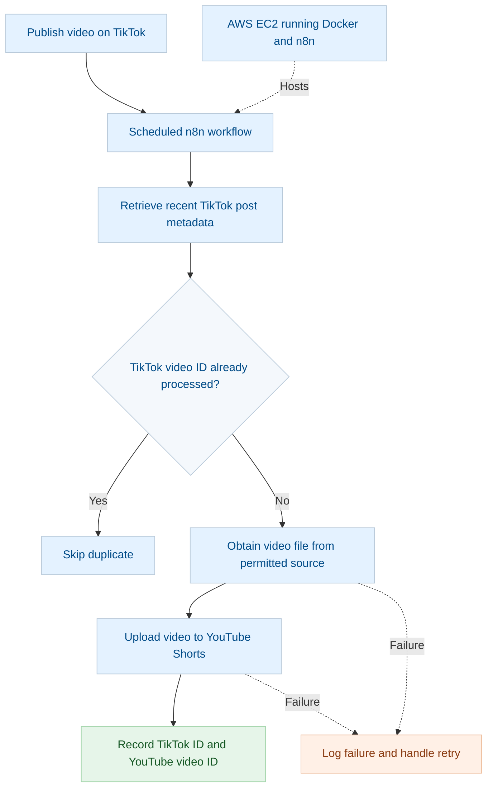

# TikTok to YouTube Shorts Automation with n8n and AWS

> **Status:** In progress  
> **Goal:** Build a secure, low-cost workflow that detects new videos from my TikTok account and automatically publishes them to YouTube Shorts.

## Overview

This project explores how to automate short-form video distribution using **n8n**, **AWS**, and the **YouTube Data API**.

The intended workflow checks for new TikTok posts, prevents duplicate processing, obtains the video file through a reliable and permitted source, uploads it to YouTube Shorts, and records the outcome.

The workflow is still being implemented. The architecture below describes the intended design, not a completed or verified deployment.

## Architecture (planned)

## Objectives

- Detect new videos published on my TikTok account.
- Retrieve the video file through a reliable, permitted method.
- Upload videos to my YouTube channel as Shorts.
- Prevent duplicate uploads.
- Store API credentials securely.
- Log successful uploads and errors.
- Run the workflow continuously on AWS, subject to account permissions and cost.
- Document setup, testing, security and lessons learned.

## Technology Stack

| Technology | Purpose |
|---|---|
| n8n | Workflow orchestration and scheduling |
| AWS EC2 | Planned always-on hosting |
| Docker | Run n8n in a reproducible environment |
| TikTok for Developers | Access permitted TikTok post metadata |
| YouTube Data API | Authorised YouTube video uploads |
| Git and GitHub | Source control and project documentation |
| OAuth 2.0 | Authorise access to the relevant accounts |
| Persistent storage | Track processed video IDs and upload status |

## Workflow Design

### 1. Detect New TikTok Posts

A scheduled n8n workflow will periodically check for recent posts using an authorised method.

### 2. Check for Duplicates

Each video will be identified by its unique TikTok video ID. The workflow will compare the ID against a persistent record of previously processed videos.

### 3. Obtain the Video File

The workflow must obtain the actual video file from a reliable, permitted source. Post metadata or an embed URL alone may not provide a downloadable MP4. This is a key technical dependency to validate before end-to-end testing.

### 4. Upload to YouTube Shorts

The workflow will upload the video to the authorised YouTube channel using OAuth credentials and the YouTube Data API or an appropriate n8n integration.

### 5. Record the Result

After a successful upload, the workflow will save the TikTok video ID, YouTube video ID, processing status and timestamps.

### 6. Handle Errors

Failures will be logged with enough detail to troubleshoot. Retries will be designed carefully so an uncertain upload result does not cause duplicate videos.

## Duplicate Prevention

The TikTok video ID will be the unique identifier for each source post.

Suggested statuses:

- `detected`
- `uploading`
- `published`
- `failed`

Before uploading, check the persistent store for an existing record. After success, save the resulting YouTube video ID. If a failure occurs, inspect the upload result before retrying.

## AWS Hosting Plan

AWS EC2 is being considered for running Docker and n8n continuously.

Before creating resources:

- Verify the active AWS identity.
- Check permissions for EC2 and networking resources in `eu-west-2` (London).
- Investigate any organisation Service Control Policy (SCP) restrictions encountered in the existing AWS account.
- Estimate instance, storage, network and backup costs.
- Configure budget alerts.
- Do not attempt to bypass organisational restrictions.

The first tests should be run locally where practical. AWS deployment will follow only after the access and cost checks are complete.

## Security

- Keep API keys, OAuth tokens, refresh tokens and AWS credentials out of GitHub.
- Use n8n's credential store for service credentials.
- Apply least-privilege AWS permissions.
- Protect the n8n editor with authentication.
- Use HTTPS before exposing n8n to the internet.
- Use a strong n8n encryption key and protect backups.
- Keep Docker images and n8n updated.
- Limit inbound network access.
- Do not put secrets in logs, screenshots or issue reports.

## Testing Checklist

### Environment

- [ ] Verify AWS identity with `aws sts get-caller-identity`.
- [ ] Check required AWS permissions.
- [ ] Confirm cost expectations before provisioning resources.
- [ ] Run n8n locally using Docker.

### Integrations

- [ ] Configure approved TikTok API access, if available for the intended use.
- [ ] Configure YouTube Data API and OAuth.
- [ ] Confirm the workflow can retrieve recent TikTok post metadata.
- [ ] Validate the method used to obtain the video file.

### Workflow

- [ ] Detect a newly published TikTok post.
- [ ] Confirm an already processed post is skipped.
- [ ] Upload a test video with private visibility first.
- [ ] Save the YouTube video ID after a successful upload.
- [ ] Test missing video files and API errors.
- [ ] Test safe retry behaviour.
- [ ] Confirm scheduled execution works.
- [ ] Deploy to AWS only after local tests pass.

## Current Progress

- [x] Defined the project goal and intended workflow.
- [x] Selected n8n for workflow orchestration.
- [x] Identified AWS as the planned hosting option.
- [x] Documented duplicate prevention and security requirements.
- [ ] Verify AWS identity and permissions.
- [ ] Resolve any AWS organisation policy restrictions.
- [ ] Choose and validate a reliable video-file retrieval method.
- [ ] Implement the n8n workflow.
- [ ] Complete a successful end-to-end test.
- [ ] Deploy and monitor the workflow.

## Lessons and Learning Goals

This project is intended to develop practical experience with:

- Workflow automation and scheduling
- API integration and OAuth 2.0
- Docker and Linux
- AWS infrastructure and permissions
- Data persistence and idempotency
- Error handling, logging and retries
- Secure configuration management
- GitHub documentation and version control
- Cost awareness for cloud deployments

## Useful Resources

- [n8n documentation](https://docs.n8n.io/)
- [n8n Docker installation](https://docs.n8n.io/hosting/installation/docker/)
- [AWS EC2 documentation](https://docs.aws.amazon.com/ec2/)
- [TikTok for Developers](https://developers.tiktok.com/)
- [YouTube Data API documentation](https://developers.google.com/youtube/v3)
- [YouTube video upload endpoint](https://developers.google.com/youtube/v3/docs/videos/insert)
- [Docker](https://www.docker.com/)

## Target Outcome

Deliver a maintainable automation that detects my own new TikTok posts and publishes them to YouTube Shorts with minimal manual intervention, duplicate prevention, secure credentials, error logging and cost awareness.

**The project will only be marked complete after the end-to-end workflow has been implemented and successfully tested.**
